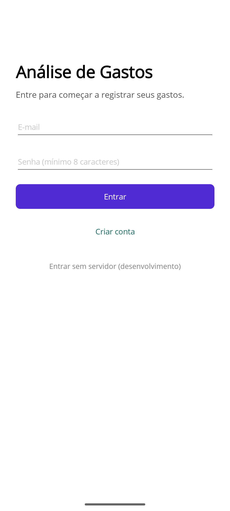
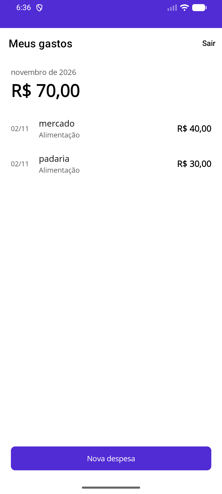
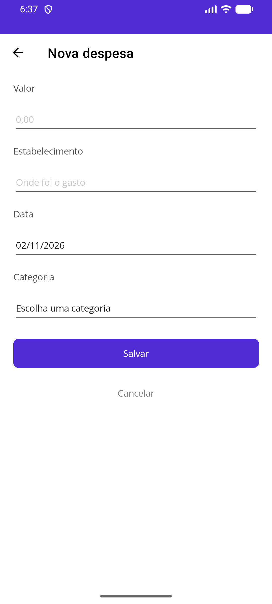

# Sistema de Análise de Gastos

Projeto Integrador — Curso Superior de Tecnologia em Análise e Desenvolvimento
de Sistemas, IFSP Câmpus Guarulhos.

Alanis Angelo Ortolani e Arthur Alves Lima
Orientador: Prof. Giovani Fonseca

---

## Versão atual: v0.1.0

Primeira entrega de código (03/11/2026), com cerca de 20% do escopo:

- **Autenticação:** criação de conta e login com e-mail e senha, pela API.
  A senha é guardada no servidor apenas como resumo criptográfico (BCrypt).
- **Cadastro manual de despesas:** valor, estabelecimento, data e categoria,
  com edição e exclusão.
- **Lista do mês:** despesas do mês corrente e o total do período.
- **Funcionamento sem internet:** os dados ficam no banco SQLite do aparelho.
  Depois do primeiro login, o aplicativo abre direto, mesmo sem conexão.

| Entrada | Meus gastos | Nova despesa |
|---|---|---|
|  |  |  |

**Ainda não incluído nesta versão:** sincronização entre aparelho e servidor
(a API já tem o endpoint, mas o aplicativo ainda não o chama), captura por
câmera e QR Code, análise por inteligência artificial e dashboards.

---

## Estrutura

```
Gastos.sln
src/
  Gastos.Shared/      biblioteca compartilhada: classes de domínio e contrato da API
  Gastos.Api/         ASP.NET Core — autenticação e sincronização (MySQL)
  Gastos.App/         aplicativo .NET MAUI (SQLite no aparelho)
    Views/            telas (XAML)
    ViewModels/       lógica das telas (MVVM, CommunityToolkit.Mvvm)
    Dados/            banco local e repositórios
    Servicos/         autenticação e sessão
docs/
  decisoes/           registros de decisões de arquitetura (ADR)
  prints/             capturas de tela das versões
```

`Gastos.Shared` não depende de nenhuma biblioteca externa. Isso é deliberado:
as mesmas classes de domínio são usadas pelo aplicativo e pela API, e cada lado
declara seu próprio mapeamento. Não existe risco de os dois divergirem.

---

## Antes de rodar

Instale:

- **Visual Studio 2022** ou superior, com as cargas de trabalho
  *Desenvolvimento para dispositivos móveis com .NET* e
  *Desenvolvimento web e ASP.NET*;
- **.NET SDK 10**;
- **MySQL Server** e **MySQL Workbench**.

No MySQL Workbench, crie o banco vazio:

```sql
CREATE DATABASE gastos CHARACTER SET utf8mb4 COLLATE utf8mb4_unicode_ci;
```

As tabelas são criadas sozinhas na primeira execução da API.

---

## Configurar os segredos da API

A senha do MySQL e a chave do JWT **não** vão para o `appsettings.json`, que é
versionado. Use o cofre local do .NET, cada integrante na própria máquina:

```bash
cd src/Gastos.Api
dotnet user-secrets set "ConnectionStrings:MySql" "server=127.0.0.1;port=3306;database=gastos;user=root;password=SUA_SENHA"
dotnet user-secrets set "Jwt:Chave" "uma-frase-longa-e-aleatoria-com-pelo-menos-32-caracteres"
```

Cada comando precisa estar inteiro em uma linha. Para conferir o que foi salvo:
`dotnet user-secrets list`.

Use `127.0.0.1`, e não `localhost`: com `localhost`, o MySQL pode identificar a
conexão pelo nome do computador e recusá-la com
*"Host '...' is not allowed to connect"*.

---

## Rodar

**1. API** — em um terminal, que deve ficar aberto:

```bash
cd src/Gastos.Api
dotnet run
```

A API sobe em `http://localhost:5000`. O Swagger, em
`http://localhost:5000/swagger`, permite testar cadastro e login sem o
aplicativo.

**2. Aplicativo** — no Visual Studio:

1. Abra `Gastos.sln` e defina **Gastos.App** como projeto de inicialização.
2. Escolha um emulador em **Android Emulators** (criado em
   *Ferramentas → Android → Gerenciador de Dispositivos Android*).
3. Execute com F5.

O aplicativo procura a API em `http://10.0.2.2:5000`, que é como o emulador
Android enxerga o `localhost` do computador. Em aparelho físico, troque esse
endereço em `MauiProgram.cs` pelo IP do computador na rede local.

Em compilação de desenvolvimento (Debug), a tela de entrada mostra o botão
**Entrar sem servidor**, que permite usar o aplicativo sem a API no ar.

**Pouco espaço no disco C:?** O emulador ocupa de 6 a 10 GB. Para guardá-lo em
outro disco, crie a variável de ambiente `ANDROID_AVD_HOME` apontando para uma
pasta nesse disco (por exemplo, `setx ANDROID_AVD_HOME D:\Android\avd`),
reabra o Visual Studio e crie o emulador.

---

## Endpoints

| Método | Rota | Protegido | O que faz |
|---|---|---|---|
| POST | `/auth/cadastro` | não | Cria a conta e devolve o token |
| POST | `/auth/login` | não | Autentica e devolve o token |
| POST | `/sinc` | sim | Envia a fila e recebe o que mudou no servidor |

As rotas protegidas exigem o cabeçalho `Authorization: Bearer <token>`.

---

## Decisões que o código implementa

Cada uma está justificada no Capítulo 2 do relatório técnico.

**Banco local como fonte de verdade.** As telas leem e gravam sempre no SQLite
do aparelho. Toda gravação também entra numa fila, na mesma transação, para ser
enviada ao servidor depois.

**Identificadores em `Guid`.** O dispositivo precisa criar registros sem
consultar o servidor. Inteiros sequenciais colidiriam entre aparelhos.

**Exclusão lógica (`Excluido`).** Apagar a linha do banco local faria a
sincronização seguinte restaurar o registro a partir do servidor.

**Conflito pela alteração mais recente (`AtualizadoEm`).** Quando o mesmo
registro muda nos dois lados, vence o mais recente. A versão preterida se perde
— limitação assumida e registrada no relatório.

**Senha com BCrypt.** O banco guarda o resumo criptográfico, nunca a senha.

**Cadastro só com e-mail.** Nome e documentos não são coletados. É a aplicação
concreta do princípio da necessidade, tema de pesquisa atribuído pelo
orientador.

**Credenciais no servidor.** A cadeia de conexão do MySQL e a chave do JWT ficam
na API. O aparelho guarda apenas o identificador da conta e o token, no
armazenamento seguro do sistema operacional.

---

## Pendências conhecidas

- O pacote `SQLitePCLRaw` 2.1.11, usado pelo Entity Framework no aplicativo, tem
  vulnerabilidade conhecida no SQLite (CVE-2025-6965). A correção exige migrar
  para a versão 3.0 e foi adiada para depois desta entrega. O risco é baixo: o
  banco é local e contém apenas dados do próprio usuário.
- O `MySqlConnector` 2.4.0, usado pela API, também tem aviso de vulnerabilidade
  e será atualizado na mesma rodada.
- O tráfego HTTP sem criptografia está liberado no Android apenas para os testes
  locais com a API.

---

## Fluxo de trabalho

- `main`: versão estável, atualizada a cada entrega da disciplina;
- `develop`: integração do trabalho em andamento;
- `feature/...`, `fix/...`, `docs/...`: uma ramificação por tarefa, criada a
  partir da `develop`.

Toda alteração chega à `develop` por *pull request* vinculado a uma *issue* e
revisado pelo outro integrante. Os *commits* seguem o padrão *Conventional
Commits*. Cada entrega vira uma *release* com versionamento semântico
(`v0.1.0`, `v1.0.0`).
